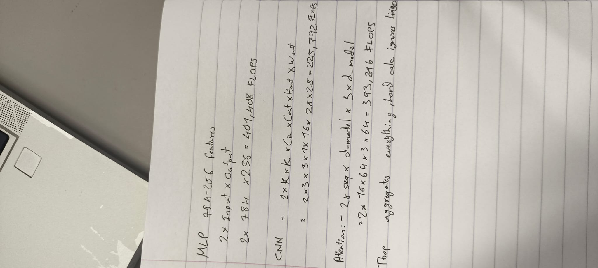
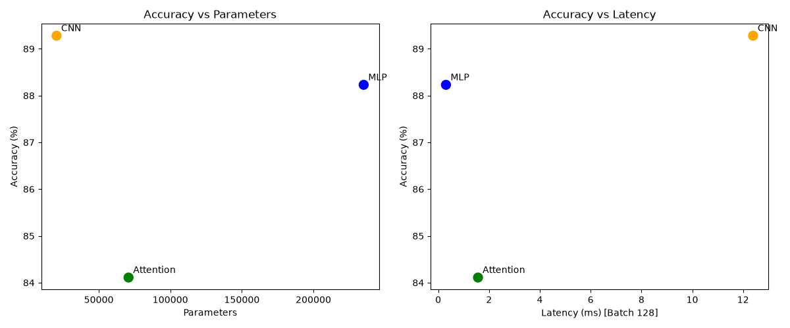

# Lab 3: Architectures and their Costs

## 1. Hand-Calculated vs. Measured FLOPs

* **Gap Explanation:** The hand calculations only account for the fundamental multiply-add operations of a single specific layer (ignoring biases). The `thop` profiler counts Multiply-Accumulate operations (MACs) for the *entire* network architecture, including activation functions, pooling layers, layer normalization, and the final linear classification heads, which naturally results in much higher total network FLOPs.

## 2. Architecture Trade-offs and Access Patterns

Based on the profiling and training results, the architectures exhibit distinct trade-offs tied to their memory access patterns:

* **CNN (Most Cost-Effective for Accuracy):** The CNN achieved the highest accuracy (89.28%) with the lowest parameter count (20k). This is due to **spatial locality** and **weight sharing**. By sliding filters across the image, it reuses weights, making it highly parameter-efficient. However, the sequential nature of pooling and spatial convolutions resulted in the highest latency (12.39 ms for batch 128).
* **MLP:** The MLP achieved strong accuracy (88.23%) and very low latency (0.306 ms), but at the cost of massive parameter bloat (235k). The **dense matrix multiplications** require unique weights for every input-to-output connection. This means no weight reuse, creating high memory bandwidth requirements and making it incredibly inefficient to scale to larger images.
* **Attention Model:** The miniature Vision Transformer had moderate parameters (70k) and low latency (1.56 ms) but the worst accuracy (84.11%). While self-attention creates a global receptive field, it requires **quadratic memory access ($O(N^2)$)** relative to the sequence length. Because our sequence length was small (16 patches), the latency remained low. However, Attention models lack the strong spatial inductive biases of CNNs, meaning they typically require significantly more data and training time to achieve comparable accuracy on image tasks.